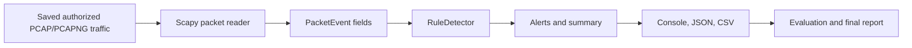

# System workflow (planned final-paper figure)

Environment documented at Milestone 2:

- Normal baseline: home Wi-Fi capture, approximately 192.168.88.0/24
- Suspicious traffic: isolated VirtualBox host-only network, 192.168.56.0/24
- Windows scanner 192.168.56.1 → Linux Mint test VM 192.168.56.101

These are the team's previously documented experimental conditions. Verify them with the capture data and test notes before writing the final paper. The code does not open sockets to scan or attack any host.
